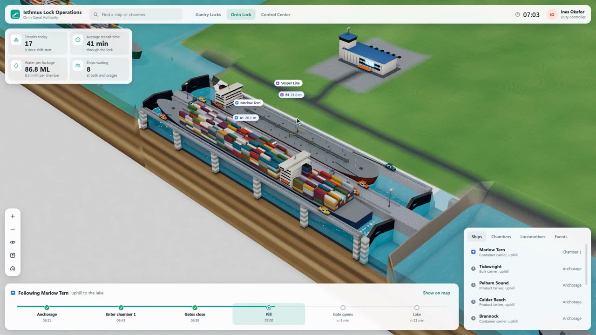
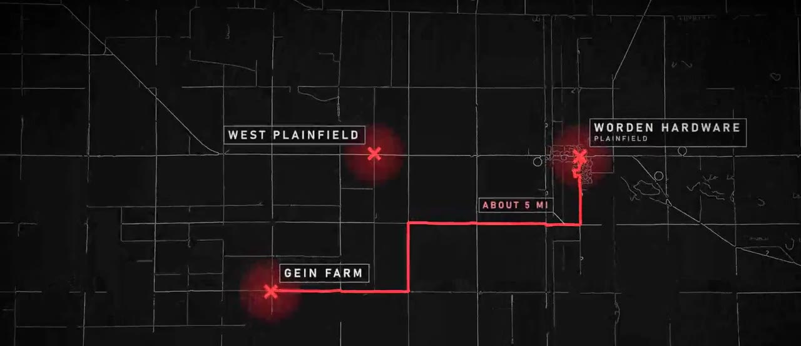
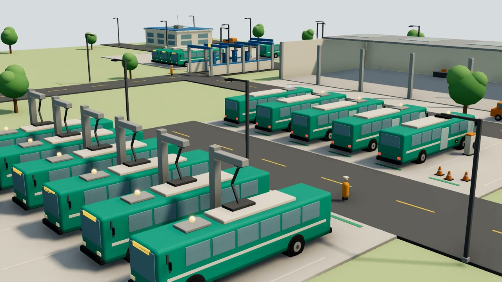
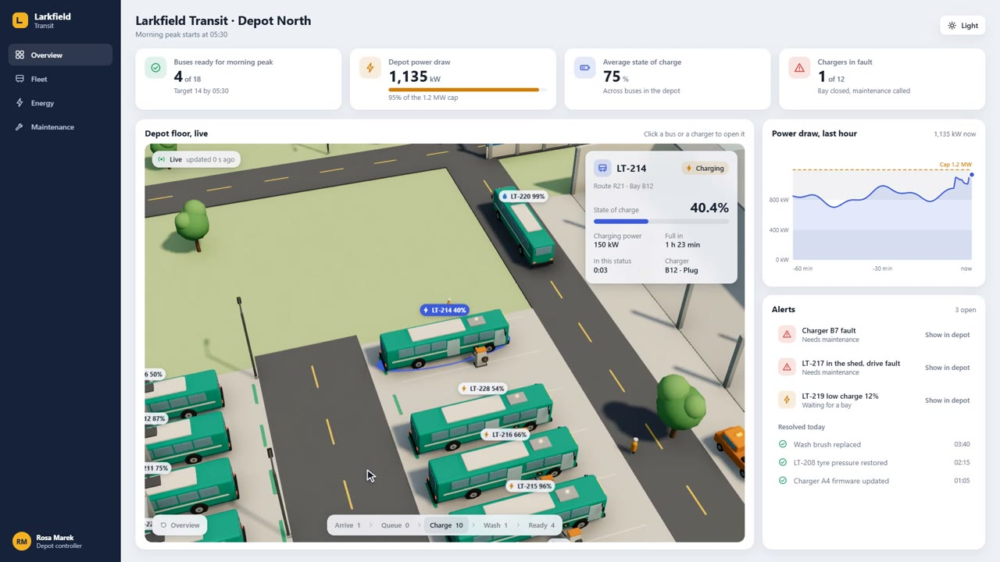
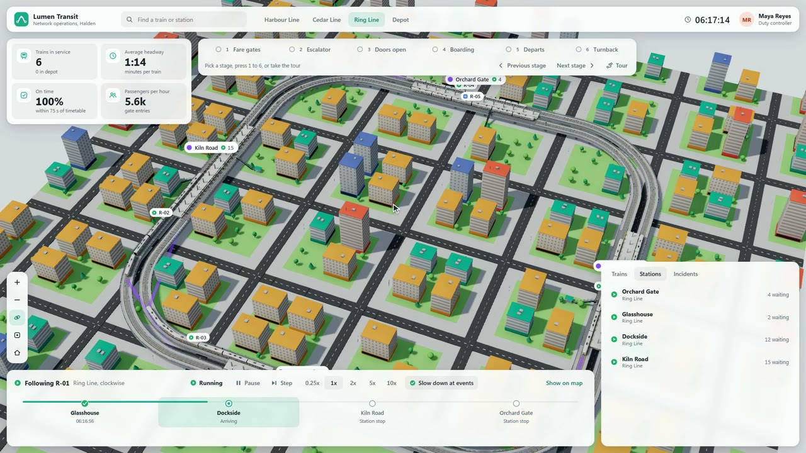

# CodePawl skills

Agent skills we use to build things with Claude Code. Each skill is a folder with a `SKILL.md` entry point and the
references it reads.

## visualize-in-3d

Some things are hard to understand from text, a spreadsheet or a two-hour documentary. How does an airport turn a plane
around in 45 minutes? What does an ER do with ten arrivals at once? How does a metro keep trains two minutes apart, or
a toll gantry charge a truck at full speed? Why did a reactor explode at 01:23?

This skill has your agent turn questions
like these into a 3D world you can watch or click through. The world is built from researched facts and from models
made to real dimensions.

It has four modes:

- **Live app**: a three.js app with a dashboard around a 3D world of the place. A seeded simulation moves the units and
  the numbers. The agent records a 30 s film by driving the app with real clicks on a virtual clock.
- **Documentary film**: a 2 to 4 minute film of an event, told in order. It is built from a sourced fact file, a map,
  block-built scenes and flat glowing figures. Captions are timed for reading, and the score changes with the story.
- **Quick prototype**: a live app in one pass from three.js primitives, with no Blender. Use it when you need something
  to show your leads this week.
- **Live embed**: the 3D view as a web component (`<viz3d-world>`) or an iframe page that goes into the dashboard or
  product you already have. It reads your real data from REST, Server-Sent Events, WebSocket or a CSV export through a
  field mapping file, so a new feed needs no code change. Tokens stay on your backend.

| Live app | Documentary film |
|---|---|
|  |  |
| **Quick prototype** | **Live embed** |
|  |  |

Every live app has stage cameras on number keys, a guided tour, follow camera and playback from 0.25x to 10x:



There are four looks: toy isometric, point-cloud survey, photoreal terrain and dark documentary.

### Install

In Claude Code, add this repository as a plugin marketplace and install the plugin:

```text
/plugin marketplace add codepawl/viz3d
/plugin install visualize-in-3d@codepawl
```

From a shell, the same two steps are:

```bash
claude plugin marketplace add codepawl/viz3d
claude plugin install visualize-in-3d@codepawl
```

For Claude Code, Codex, Cursor and other agents that read skill folders, use the [skills CLI](https://github.com/vercel-labs/skills):

```bash
npx skills add codepawl/viz3d
```

To install by hand, copy `plugins/visualize-in-3d/skills/visualize-in-3d` into your agent's skills folder (for Claude
Code, `~/.claude/skills/`).

### Use

Ask for what you want to see, for example:

- "Visualize how a container port works."
- "Show how a city metro keeps its trains apart."
- "Make a documentary-style 3D film of the 1906 San Francisco earthquake."
- "Make a quick 3D prototype of our warehouse for Monday's leadership review. Here is last week's CSV export."
- "Put a live 3D view of our fleet in our ops dashboard. The feed is at /api/fleet/events."

The agent writes a topic file first, then builds the models, then the app or the film. It checks its own film on
contact sheets before it shows you anything.

For a live embed, the agent builds a web component and an iframe page. Put the component in any page and point it at
your feed:

```html
<script type="module" src="/viz3d-world.js"></script>
<viz3d-world source="https://ops.example.internal/events" mapping="/mapping.json" chrome="panel"></viz3d-world>
```

`mapping.json` links your field names and status codes to the 3D view, so a new feed needs no code change. For a tool
that only takes a URL, use `embed.html?source=...` in an iframe. To test without your real system, the skill's
`scripts/mock-feed.mjs` replays a JSONL file as a live feed.

### What you need

- Node 20 or later, with Playwright and Chromium for recording.
- ffmpeg on your PATH.
- A GPU that runs WebGL2 at 1080p.
- [Blender](https://www.blender.org/download/) 5.x is optional. It gives much better models for the full live app and
  the documentary. Without it the skill builds the models in three.js and tells you the quality is lower. Quick
  prototypes and embeds never need it.

The skill asks before it downloads anything, such as elevation data, map data or reference images.

## License

MIT
